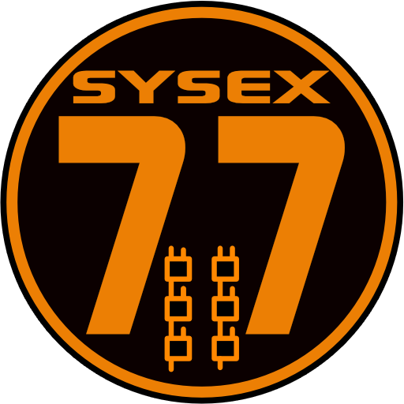
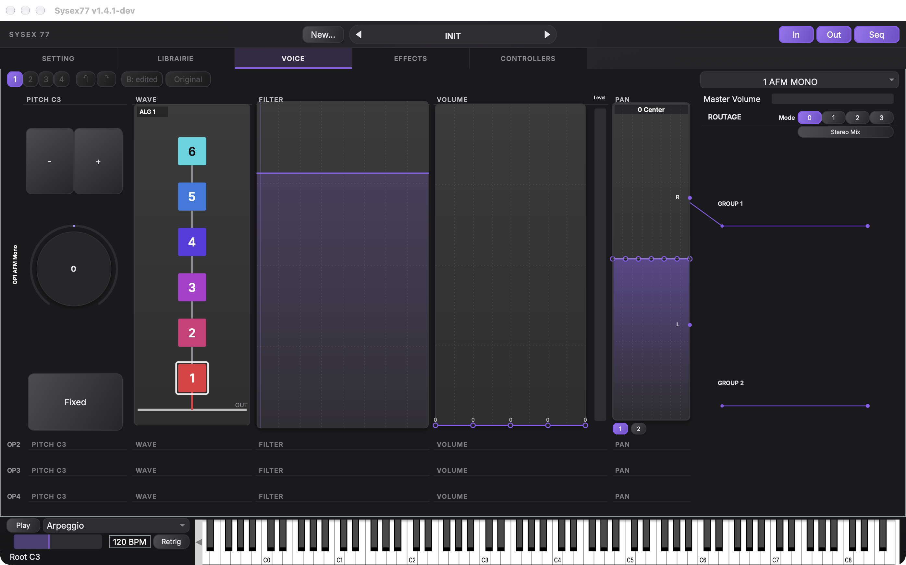
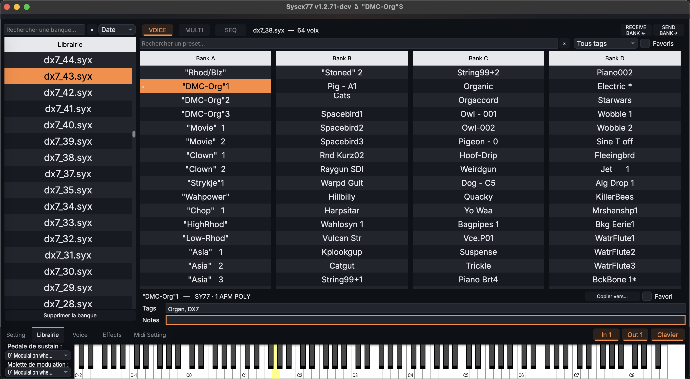
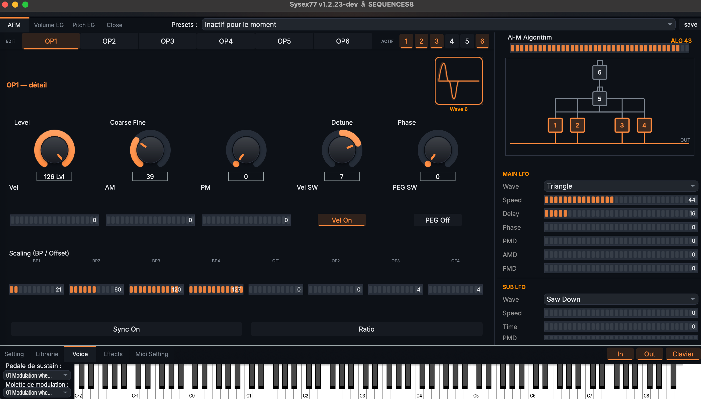

# Sysex77 — éditeur MIDI pour Yamaha SY77 / SY99 (EN / FR)



Éditeur de sysex (presets & banques) pour les Yamaha **SY77 / SY99 / TG77**, écrit en C++/JUCE.
Inspiré, côté fonctionnalités, de l'éditeur *SynthWorks SY77*.

> ⚠️ **Projet en cours de développement** — à utiliser avec précaution.
> L'envoi de banques peut **écraser les patchs de votre synthé** : faites une sauvegarde et
> désactivez le *bulk protect* au préalable.

**Contributions bienvenues** — quiconque souhaite contribuer, voire reprendre le projet, est le bienvenu.



---

## Fonctionnalités

- **Éditeur de voix** AFM / AWM : opérateurs, oscillateurs, filtres, enveloppes, pan.
- **Interface repensée** : **bandeau supérieur** permanent (nom de la voix, flèches voix
  précédente/suivante, *New…*, indicateurs In/Out/Seq), **onglets en haut**, écran Voice épuré,
  en-tête **« < Voice »** commun à tous les éditeurs (re-clic sur VOICE ou Échap pour fermer),
  boutons désactivés clairement visibles.
- **Rendu de la forme d'onde FM** reproduisant la topologie réelle des **45 algorithmes** du SY77.
- **Édition à la souris des graphes** : glisser sur la réponse du **filtre** (cutoff/résonance) et
  sur les nœuds des **enveloppes** (niveau + rate) — vignettes d'élément et éditeurs complets.
- **Enveloppes** : clic droit (reset du point / des niveaux, copier-coller entre EG du même genre),
  Shift = réglage fin, double-clic = remise au centre, repère KEY OFF ; **loop point** et **hold
  time** de l'EG d'amplitude AFM (flèche LOOP sur le graphe).
- **Level Scaling graphique** : 4 break-points × offset au-dessus d'une bande clavier (offsets envoyés
  sur 2 octets comme le veut la spec).
- **Algorithme** : niveaux d'entrée (SHIFT) et correction de sortie (COR) par opérateur.
- **Onglet Contrôleurs** (Controller Set du SY77) : pitch bend molette/aftertouch, modulations
  pitch/amp/filtre, pan LFO/bias, cutoff/EG bias, volume, micro tuning, random pitch, portamento.
- **AWM** : Pitch EG, onglet LFO, mode Hold de l'EG, chargement complet depuis le dump.
- **Onglet Effets** : Effect Mode (0..3, topologie du mode affichée) + 2 unités Modulation + 2 unités Reverb.
- **Séquenceur de phrases** (bandeau bas : Rien / Clavier / Séq.) : joue une phrase en boucle
  pendant l'édition (note tenue, accord, arpège, basse, mélodie, nappe…), tempo réglable,
  transposition au clavier, mode *Relance* après chaque modif, pause automatique pendant un envoi
  de banque. **Canal de jeu** du clavier / séquenceur réglable (Setting).
- **Raccourcis clavier configurables** : Cmd+1..6 pour les onglets, Échap ferme l'éditeur,
  Cmd+P lance/arrête le séquenceur, Cmd+Z / Cmd+Maj+Z annuler/rétablir, Cmd+B comparaison A/B,
  Cmd+N nouvelle voix, Cmd+↑/↓ voix précédente/suivante (audition), Cmd+←/→ banque
  précédente/suivante, **Cmd+/ affiche la liste des raccourcis** (Réglages > Général > Raccourcis
  clavier ; compatible AZERTY ; les infobulles affichent le raccourci en cours).
- **Annuler / rétablir**, **comparaison A/B** avec l'original, **retour à l'original** (annulable)
  et **nouvelle voix depuis un modèle** (Init AFM, FM 2 opérateurs, Init AWM, couche AFM + AWM).
- **Librairie de banques** (`.SYX`) moderne : **envoi/réception** avec barre de progression,
  **suppression** de banque, **recherche** (banques et presets), **tri**, **métadonnées par preset**
  (tags, notes, favoris), **recherche globale + filtre par tag** transversale à toutes les banques,
  **filtre par synthé** (si plusieurs présents) et **copie d'un preset** vers une banque perso.
  Double-clic sur une voix = envoi au synthé (audition dans l'edit buffer) + ouverture dans l'éditeur.
  **Badge de type** par preset (1AFM, 2AWM, DRUM…) et **preset suspect en rouge** (en-tête, taille
  ou checksum incohérents). Les banques mixtes (multis, tables de pan, système) n'affichent que les voix.
- **Chargement des dumps plus complet** : effets, LFO, filtres AFM/AWM (type, cutoff, EG,
  scaling), rate scaling des opérateurs, commun d'élément, source d'onde AWM ; **voix Drum** décodées.
- **Éditeur de voix Drum** : tableau des 61 touches (C1..C6) avec onde, volume, accord,
  transposition, pan, sorties et groupe alterné en barres comparables, et panneau d'édition de la
  touche sélectionnée (bouton *Play* pour l'écouter ; annuler/rétablir et A/B inclus).
- **Éditeur de Multi** (onglet Multi) : 16 parties en tableau (voix, volume, accord,
  transposition, pan, sorties) et édition de la partie sélectionnée, nom éditable, ouverture depuis
  la bibliothèque (bouton MULTI) ou demande au SY77, envoi du Multi complet au tampon d'édition
  (avec confirmation). Les réglages Multi ne passent jamais par l'annulation des voix.
- **Organisation des banques** (clic droit sur une voix) : dupliquer, déplacer, échanger,
  remplacer par une voix Init, copier vers une banque — numéros d'emplacement et checksums
  recalculés, Multi de la banque mis à jour, voix à 4 éléments limitées à la banque D,
  tags/notes conservés, sauvegarde `.bak`.
- **Quadratic Mixture** (clic droit sur une voix de la librairie) : 4 voix du même type aux coins
  d'un pad, la position du curseur mélange enveloppes, niveaux, filtres et LFO. *TEST* l'écoute
  dans le tampon d'édition, *STORE* l'ajoute à la banque `Mixtures.syx` de la librairie (rien n'est
  écrit dans une mémoire du synthé).
- **Cartes d'ondes AWM** : noms d'ondes des cartouches (W77xx pré-remplies) éditables dans
  *Setting > Wave cards...*.
- **Mode développeur** : vue hexa d'un preset de la librairie avec l'interprétation de chaque octet
  (clic droit ou Cmd+Maj+H).
- **Persistance** des réglages : interfaces MIDI, device number, taille de fenêtre, onglet,
  clavier, et **couleurs personnalisées** (thème custom).
- Synchronisation **tout-MIDI** bidirectionnelle (un seul *device number* global).
- **Mise à jour intégrée** : l'app vérifie les *GitHub Releases* au démarrage et propose de
  télécharger + installer la nouvelle version automatiquement (macOS ; désactivable dans *Setting*).
  Sous Windows / Linux, elle ouvre la page de la release.

> ⚠️ Certaines éditions (effets, groupes, enveloppes…) sont pour l'instant en **rendu/état seul**
> côté éditeur ; l'envoi sysex complet vers le synthé est en cours de fiabilisation. Tous n'est pas implémenté.

📋 **État de validation paramètre par paramètre** (envoi → synthé / ouverture dump → éditeur) :
voir **[MAP.md](MAP.md)**.

---

## Lancer l'app pré-compilée (macOS)

L'application macOS pré-compilée est fournie dans **`dist/Sysex77.app`** (Apple Silicon / arm64).
Elle n'est **pas signée ni notariée** par Apple : au **premier lancement**, macOS la bloque
(« développeur non identifié »). Pour l'autoriser :

1. **Clic droit** (ou Ctrl-clic) sur `dist/Sysex77.app` → **Ouvrir** → puis, dans la boîte de
   dialogue, cliquez encore sur **Ouvrir**. *(Une seule fois ; ensuite, double-clic normal.)*
2. **Sans Terminal** (macOS récent) : double-cliquez l'app une fois (elle est bloquée), puis allez
   dans **Réglages Système → Confidentialité et sécurité** ; tout en bas, un message « Sysex77 a
   été bloqué… » propose **« Ouvrir quand même »** → cliquez, puis **rouvrez l'app** et confirmez.
3. *(Dernier recours, Terminal)* si l'app est dite « endommagée » après **téléchargement**
   (quarantaine), retirez l'attribut :
   ```bash
   xattr -dr com.apple.quarantine dist/Sysex77.app
   ```

> ⚠️ Binaire **Apple Silicon (arm64)** pour l'instant. Sur Mac **Intel** (ou en cas de doute),
> compilez depuis les sources (ci-dessous) — c'est tout aussi simple.

## Windows / Linux

Chaque release (à partir de la v1.5.0) contient aussi, compilés par la CI GitHub :

- **Windows** : `Sysex77-<version>-windows-x64.zip` — dézippez puis lancez `Sysex77.exe`.
  L'exécutable n'est **pas signé** : Windows SmartScreen affiche « Windows a protégé votre
  ordinateur » → **Informations complémentaires** → **Exécuter quand même**.
- **Linux** (x64) : `Sysex77-<version>-linux-x64.tar.gz` — `tar xzf …` puis `./Sysex77`.
  Nécessite ALSA (et JACK si utilisé), FreeType, fontconfig et X11, présents sur la plupart des
  distributions de bureau.

Ces versions sont compilées et testées automatiquement (tests unitaires) mais **pas encore
essayées avec un SY77 réel** — retours bienvenus.

---

## Build (sans Projucer)

Compilation via CMake — **pas besoin de Projucer**, et **JUCE est téléchargé
automatiquement** s'il est absent. Idéal pour les utilisateurs **non-Mac** (l'app pré-compilée
n'est fournie que pour macOS).

```bash
./build.sh --test     # macOS / Linux
build.bat  --test     # Windows
```

📖 **Guide complet** (prérequis par OS, options, dépannage) : voir **[BUILD.md](BUILD.md)**.

---

## Utilisation

À l'ouverture (après l'image d'accueil) : sélectionnez votre interface MIDI, puis le **device
number (canal)** dans *Setting*. Vous pouvez y activer/désactiver le *bulk protect* (ou le faire
sur le synthé) pour autoriser les échanges de banques ; le choix est mémorisé et, s'il est
désactivé, renvoyé au synthé à chaque démarrage.

- **SY99** : choisissez *SY 99* dans les paramètres, fermez et rouvrez l'application (la liste des
  waves correspondra à votre synthé).
- Cliquez en haut de la page (ou dans une zone noire) pour faire apparaître le menu.
- La **Librairie** gère vos banques `.SYX`. On en trouve beaucoup en ligne, par ex.
  http://bobbyblues.recup.ch/yamaha_sy77/sy77_patches.html
  *(Pensez à sauvegarder vos banques et à désactiver le bulk protect avant tout envoi.)*
  - **Recevoir / Envoyer** une banque (barre de progression, débit adapté au SY77), **supprimer**
    une banque, **rechercher** et **trier** la liste.
  - **Métadonnées par preset** : sélectionnez une voix → panneau d'inspection (nom · synthé · type)
    pour saisir **tags**, **notes** et **favori** ; un repère ★/• apparaît dans la liste.
    Tout est stocké dans `~/Library/Application Support/Sysex77/library.json`.
  - **Recherche globale de presets** (par nom ou tag, avec filtre **★ favoris**) : le panneau de
    droite bascule en liste de résultats **transversale à toutes les banques**.
  - **Copier un preset** vers une banque perso ; **filtre par synthé** lorsque plusieurs familles
    sont présentes (l'envoi/édition reste réservé au SY77).
- **Double-cliquer une voix** l'envoie au synthé (audition dans l'edit buffer, sans écraser la
  mémoire) **et l'ouvre dans l'éditeur**.



### Thèmes

L'onglet *Setting* propose un sélecteur de thème. Six palettes sont intégrées (*Dark Orange*,
*FM Dark*, *Light*, *Crimson*, *Tangerine* et **Indigo Night**, un thème « studio » : potards à
arc fin, barres plates, une couleur par opérateur, enveloppes redessinées). Le **Theme Builder**
permet en plus de choisir les **couleurs d'opérateurs** (*Monochrome*, *Spectre*, *Pastel*,
*Neon*, *Chaud* ou *Personnalisé*). Au premier lancement, elles sont exportées en tant
que fichiers éditables dans :

```
~/Library/Application Support/Sysex77/Themes/
```

Chaque thème est un sous-dossier contenant un fichier `theme.xml`. Vous pouvez :
- **Modifier** un thème intégré en éditant le `theme.xml` correspondant.
- **Créer un thème custom** : dupliquez un sous-dossier, renommez-le, éditez le `theme.xml`.
- Cliquer sur **Reload** dans *Setting* pour prendre en compte vos modifications sans relancer l'app.



---

## English (summary)

Sysex (presets & banks) editor for the Yamaha SY77/SY99/TG77, C++/JUCE.
**Not finalized — use at your own risk; sending banks can erase your synth's patches, back up first!**

Prebuilt macOS app: `dist/Sysex77.app` (Apple Silicon, **unsigned**). First launch: right-click →
Open → Open, or (recent macOS) System Settings → Privacy & Security → **Open Anyway** then reopen.
If "damaged" after download: `xattr -dr com.apple.quarantine dist/Sysex77.app`.

Windows / Linux builds (from v1.5.0) are attached to each GitHub Release by CI:
`Sysex77-<v>-windows-x64.zip` (unsigned: SmartScreen → *More info* → *Run anyway*) and
`Sysex77-<v>-linux-x64.tar.gz` (needs ALSA, FreeType, fontconfig, X11). Unit-tested in CI, not
yet tried on real hardware.

Build (no Projucer needed): `./build.sh` (macOS/Linux) or `cmake -B build && cmake --build build`
(Windows incl.). JUCE is auto-resolved (local `JUCE_DIR`, `/Applications/JUCE`, or auto-downloaded).
Run unit tests with `--test`.

On launch: pick your MIDI interface, then the device number (channel) in *Setting*; toggle bulk
protect to allow bank exchanges. The Library sends/receives sound banks (`.SYX`) with a progress
bar; double-clicking a voice auditions it on the synth (edit buffer) and opens it in the editor.

Highlights: AFM/AWM voice editor with a redesigned UI (persistent top bar with voice name,
prev/next voice arrows, New..., In/Out/Seq indicators; tabs on top; a common "< Voice" header in
every editor, closed by clicking VOICE again or Esc), FM-waveform render of the real 45 algorithms, mouse-editable
filter & envelope graphs (right-click reset/copy/paste, Shift fine, AFM EG loop point & hold),
graphical level scaling, algorithm input shift/output correction, a Controllers tab (pitch bend,
modulation, pan, bias, portamento, micro tuning), AWM pitch EG/LFO/hold, configurable keyboard
shortcuts (Cmd+1..6 tabs, Esc closes the editor, Cmd+P sequencer, Cmd+Z/Cmd+Shift+Z undo/redo,
Cmd+B A/B compare, Cmd+N new voice, Cmd+Up/Down browse voices, Cmd+Left/Right banks, Cmd+/ cheat
sheet), undo/redo + A/B compare + revert to original, new voice from templates, a **phrase sequencer** in the
bottom bar (loops a phrase while you edit; tempo, transpose, retrig, pauses during bank transfers;
settable play channel), output groups + routing, an Effects tab, and persistence of settings &
custom colours. **Modern library**: bank send/receive with progress, delete, search & sort,
**per-preset metadata** (tags, notes, favourites) in `library.json`, **global preset search +
tag filter** across all banks, per-synth filter, and copy-a-preset-to-a-user-bank (send/edit
stay SY77-only); voice-type badges (1AFM/2AWM/DRUM...), broken presets flagged red, mixed banks
show voices only. Fuller dump loading (effects, LFO, AFM/AWM filters, operator rate scaling,
element common, AWM wave source, Drum voices), a **Drum voice editor** (61-key table with wave,
volume, tune, shift, pan, outputs and alternate group, plus an edit panel for the selected key with
a Play button; undo and A/B included), a **Multi editor** (16-part table, edit the selected part,
editable name, open from the library MULTI view or request from the SY77, confirmed full send to
the edit buffer), **bank organisation** (right-click: duplicate, move, swap, replace with Init,
copy to bank; slots and checksums rewritten, the bank's multis follow, 4-element voices kept in
bank D, tags preserved, .bak backup), a **Quadratic Mixture** window (4 same-type voices at the corners of a pad;
TEST in the edit buffer, STORE to the library's Mixtures.syx bank), Bulk Protect remembered and re-sent at startup when off,
editable AWM wave-card name tables, and a
developer-mode preset hex view (right-click / Cmd+Shift+H). **Built-in updater**: checks GitHub Releases on launch and can download + install
the new version automatically (macOS; opt-out in *Setting*; opens the release page on Windows/Linux). Some editor edits are state-only for
now (full sysex send is being firmed up).

**Themes:** six built-in palettes (Dark Orange, FM Dark, Light, Crimson, Tangerine and the
"studio" **Indigo Night**: thin-arc knobs, flat bars, per-operator colours, redrawn envelopes),
selectable in *Setting*; the **Theme Builder** adds operator colour schemes (Monochrome, Spectre,
Pastel, Neon, Chaud, Personnalise). On first launch, editable `theme.xml` files are exported to
`~/Library/Application Support/Sysex77/Themes/`. Add a subfolder with your own `theme.xml` to
create a custom theme; hit **Reload** in *Setting* to pick it up without restarting.

---

## Documentation de référence

- `SY77_PARAMETERS.md` — référence sysex (format, groupes, adresses) croisée code + spec officielle.
- La spec Yamaha *SY77 MIDI Data Format* et les captures SynthWorks sont sous `docs/` (non versionné).

## Licence

Le code source de Sysex77 est sous licence **MIT** (voir [LICENSE](LICENSE)).
L'application est construite avec le framework **[JUCE](https://juce.com)**, utilisé sous licence
**AGPLv3** : les binaires distribués (application compilée) sont donc soumis aux termes de l'AGPLv3,
dont le code source complet est celui de ce dépôt.

*English:* Sysex77 source code is MIT-licensed. It is built with JUCE under the AGPLv3, so the
distributed binaries are covered by the AGPLv3 (full source: this repository).

## Soutien & remerciements

Un grand merci au **forum JUCE**, en particulier : Daniel, Jules, McMartin, matkatmusic, Xenakios, dqthebt.

*Ps : aucun animal n'a été blessé durant le développement — au contraire, un labrador a partagé
de nombreuses interrogations, et l'agitation de son train arrière n'a laissé aucun doute : « suis content » !*

— Seb
